<!-- Alok Prasad — GitHub profile README -->

---

## 01 / About

I’m **Alok Prasad**, a B.Tech Cyber Engineering student at Rungta International Skills University (2023–2027), focused on building practical software and AI-powered applications.

My work spans full-stack product development, browser-based machine learning, applied computer vision, data-driven systems, and backend architecture. I enjoy taking a problem from system design through implementation, testing, and a usable interface.

- 🌱 Currently learning **Software Development with AI & AWS Integration.**
- 🎓 B.Tech in Computer Science Engineering (Expected 2027).
- 🤖 Passionate about Web + AI applications.
- 🔗 Always eager to learn new technologies.
- 🔭 I’m currently **looking for opputunity.**
- 💡 Problem solver with a focus on practical implementation.

---

## 🎓 Education

| Institution | Degree | Duration |
|---|---|---|
| Rungta International Skills University, Bhilai | B.Tech in Cyber Engineering | 2023 - 2027 |
| Gaya College, Gaya | Intermediate Science (I.Sc) | 2020 - 2022 |
| Hansraj Public School, Gaya | Matriculation (10th Board) | 2020

---

## 🛠️ Technical Skills

### 💻 Programming Languages

### 🎨 Frontend Development

### 🖥️ Backend Development

### 🤖 AI/ML & Data Science

### 💾 Databases

### 🛠️ DevOps Tools & Cloud

![AWS]

---

## 📊 GitHub Statistics

  

<!-- Github Streak -->

  
  

<!-- Activity Graph -->

  

---

## 🔗 Connect With Me

  &nbsp;&nbsp;&nbsp;
  &nbsp;&nbsp;&nbsp;
  

---

## 💭 Favorite Quote

> 🎯 *"Code is like humor. When you have to explain it, it's bad."* – Cory House

---

  <i>Thank you for visiting my profile! Feel free to explore my projects and connect with me.</i> 😊

**Open to software engineering opportunities, collaboration, and challenging problems.**

---

*Building thoughtfully. Learning continuously. Shipping software that solves problems.*

